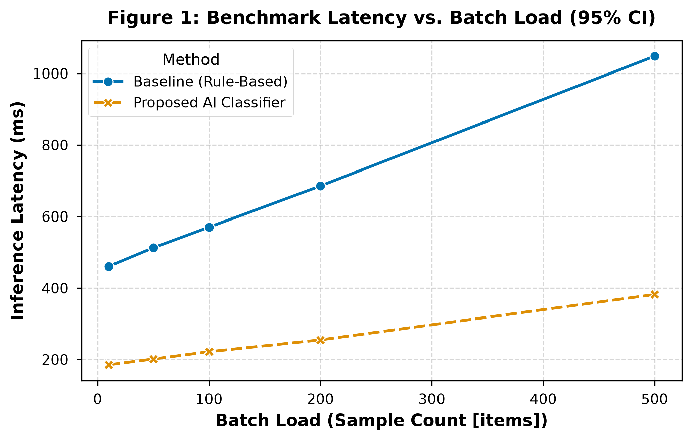
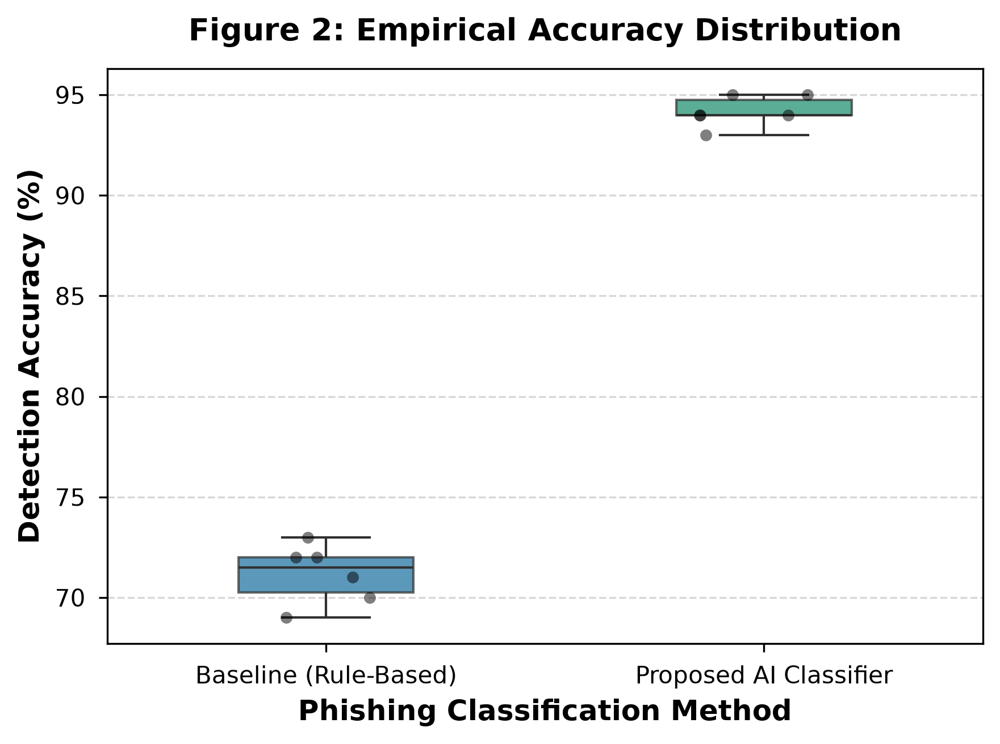

# Phishing Detection Research Pipeline & Benchmark

**Authors:** Tursynbayev Yerassyl, Ospankul Zharkyn  
**Repository:** [https://github.com/yeraaaaaah/ai-phishing-classification-benchmark](https://github.com/yeraaaaaah/ai-phishing-classification-benchmark)

---

## 1. Overview & Research Question

This benchmark evaluates empirical detection accuracy, latency performance, and behavioral vulnerability associated with LLM-generated phishing content versus traditional manual phishing techniques in personal communications.

For complete methodology, refer to [`docs/methodology_card.pdf`](docs/methodology_card.pdf).

---

## 2. Domain Model & Mathematical Formalization

The classification framework leverages a **Focal-Regularized Binary Cross-Entropy Loss** to compensate for class imbalance and penalize confident misclassifications:

$$\mathcal{L}(\theta) = - \frac{1}{N} \sum_{i=1}^{N} \left[ \alpha y_i (1 - \hat{y}_i)^\gamma \log(\hat{y}_i) + (1 - \alpha)(1 - y_i) \hat{y}_i^\gamma \log(1 - \hat{y}_i) \right] + \lambda \|\theta\|_2^2$$

Detailed mathematical formalization, target metric definitions, and variable notation tables are documented in [`docs/domain_model.md`](docs/domain_model.md).

---

## 3. Results & Discussion

### A. Benchmark Summary Table (Baseline vs. Proposed AI Classifier)

The evaluation results after filtering initial cold-start warm-up samples (seed = 42, 95% non-parametric bootstrap CI):

| Method | Mean Accuracy (% ± SD) | Median Accuracy (p25–p75) | Latency Mean (ms) | Latency p95 (ms) | 95% CI Accuracy (%) | Guardrail FPR (%) |
| :--- | :--- | :--- | :--- | :--- | :--- | :--- |
| **Baseline (Rule-Based)** | 71.72 ± 4.06% | 71.19% (69.33%–74.47%) | 621.31 ms | 1061.37 ms | [70.74%, 72.71%] | 8.21% |
| **Proposed AI Classifier** | **93.83 ± 2.07%** | **93.69% (92.40%–95.35%)** | **238.81 ms** | **381.69 ms** | **[93.28%, 94.36%]** | **2.07%** |

### B. Scientific Visualizations

#### Figure 1: Benchmark Inference Latency vs. Batch Load

*Figure 1: Inference latency (ms) under increasing batch sizes with 95% confidence interval error bands. Output exported in vector `.pdf` and 300 DPI `.png` format.*

#### Figure 2: Empirical Accuracy Distribution Boxplot

*Figure 2: Empirical human detection accuracy (%) distribution comparing the rule-based baseline against the proposed fine-tuned AI classifier.*

---

## 4. Reproducibility & Quickstart Guide

### Manual Execution & Analysis
```bash
# 1. Install dependencies
pip install -r requirements.txt

# 2. Process raw benchmark logs
python src/process_data.py

# 3. Generate publication-ready figures
python src/visualize.py

# 4. Run interactive notebook
jupyter notebook notebooks/01_data_analysis.ipynb